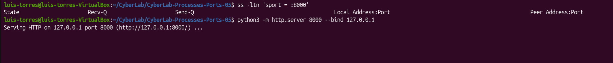
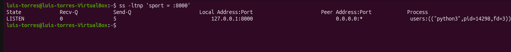
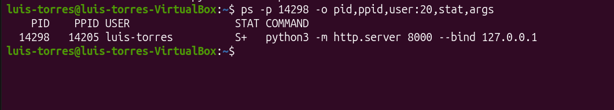
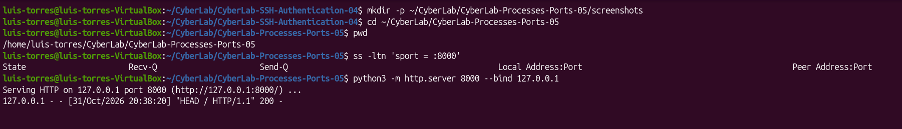
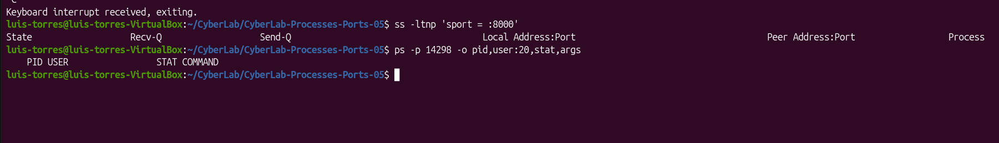

# CyberLab 05 — Linux Processes and Ports

## Objective
Identify the process behind a listening TCP port, verify its user and command, test an HTTP response, and confirm that stopping the process removes the listening socket.

## Environment
- Ubuntu Desktop running in VirtualBox
- Python 3.14.4
- Tools: ss, ps, curl
- Address: 127.0.0.1 (loopback)
- TCP port: 8000
- Lab date: October 31, 2026
- VM local time: America/New_York (EDT, UTC−04:00)

## 1. Check the Port Before Starting
Command:

`ss -ltn 'sport = :8000'`

Only the column headers appeared. No TCP listening socket was found on local port 8000.

## 2. Start a Local HTTP Server
Command:

`python3 -m http.server 8000 --bind 127.0.0.1`

The server started in the lab directory and listened on loopback. A second terminal was used for inspection while the server ran in the first terminal.

## 3. Identify the Listening Process
Command:

`ss -ltnp 'sport = :8000'`

Observed:
- State: LISTEN
- Local endpoint: 127.0.0.1:8000
- Process: python3
- PID: 14298
- Socket file descriptor: 3

The peer address 0.0.0.0:* did not indicate a connection to an external host; it was displayed for the listening socket.

## 4. Inspect the Process
Command:

`ps -p 14298 -o pid,ppid,user:20,stat,args`

Observed:
- PID: 14298
- Parent PID: 14205
- User: luis-torres
- State: S+
- Command: python3 -m http.server 8000 --bind 127.0.0.1

S indicated interruptible sleep while waiting for work. The + indicated membership in the terminal's foreground process group.

These identifiers describe this run and may differ in another session.

## 5. Test and Correlate an HTTP Request
Command:

`curl -I http://127.0.0.1:8000/`

The client sent a HEAD request and received HTTP/1.0 200 OK.

Response headers identified SimpleHTTP/0.6 Python/3.14.4 and an HTML representation with Content-Length: 305. HEAD returned headers without the response body.

The server logged:

`127.0.0.1 - - [31/Oct/2026 20:38:20] "HEAD / HTTP/1.1" 200 -`

The server's local timestamp matched the response Date header:
- Local: October 31, 2026, 20:38:20 EDT
- UTC: November 1, 2026, 00:38:20 GMT

The request used HTTP/1.1; the response used HTTP/1.0.

## 6. Stop and Verify
Pressed Ctrl+C in the server terminal.

Then ran:

`ss -ltnp 'sport = :8000'`

`ps -p 14298 -o pid,user:20,stat,args`

Both commands returned only headers. No TCP listener remained on port 8000, and PID 14298 was no longer present.

## Evidence

### Server Startup

### Listening Socket and Process

### Process Details

### Response Headers

### Server Request Log

### Shutdown Verification

## Conclusion
The listening socket was attributed to a specific Python process, user, and command. An HTTP request confirmed that the service responded, and its server log matched the client response.

After shutdown, both the process and listening socket were absent. This lab demonstrated process-to-port attribution and service lifecycle verification within one VM.

## Skills Practiced
- TCP listening socket inspection
- Process and user identification
- PID and PPID interpretation
- HTTP response inspection
- Client/server log correlation
- Time zone comparison
- Process shutdown verification
